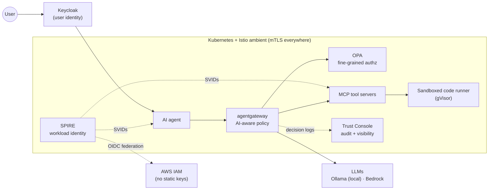
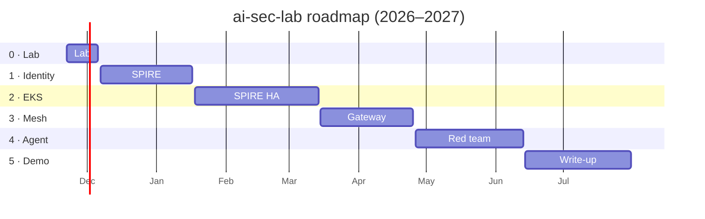

# ai-sec-lab

**A hands-on lab for learning how to give AI agents a verifiable identity, and how to keep them inside the lines once they have one.**

I'm a cloud infrastructure automation engineer. I'm comfortable with Terraform, GitLab pipelines, AWS, OPA and Go. I am *not* yet an expert in Kubernetes, workload identity, service meshes or AI agents. This repo is where I'm learning them in public, one working piece at a time, between November 2026 and July 2027.

Everything here is built to be torn down and rebuilt from code. Every phase ends with something that runs, plus notes on what I learned and what broke along the way.

---

## Why this lab exists

AI agents are starting to run inside enterprise environments. They call models, use tools, read data and act on people's behalf. That raises questions I want to be able to answer with working examples rather than slides:

- **Identity:** How does an agent prove *which* workload it is, without a long-lived secret it could leak?
- **Access:** How do we let an agent reach AWS, other services and tools with only the access it needs?
- **Delegation:** When an agent acts *for* a user, how do we carry both identities through every call?
- **Containment:** If an agent is tricked by a prompt injection, what stops it from calling out, moving sideways or escaping its sandbox?
- **Visibility:** Can we see, after the fact, which agent did what, as whom, and why it was allowed?

I don't know all the answers yet. The point of this lab is to find them by building.

## What I'm building toward

By the end, the lab should run one end-to-end system: an MCP-based agent inside a service mesh, with a SPIFFE identity, policy enforced at an AI gateway, sandboxed tools and a full audit trail.



## Roadmap



| Phase | Dates | What I'm learning | What I'll have built | Status |
| --- | --- | --- | --- | --- |
| 0 | Nov 22 – Dec 6 | Kubernetes basics, how LLMs work | Three-node `kind` cluster, local model via Ollama | 🟡 In progress |
| 1 | Dec 7 – Jan 17 | OAuth/OIDC, SPIFFE/SPIRE, AWS federation | SPIRE on `kind` with Go mTLS; a pod reaching AWS with no keys | ⚪ Not started |
| 2 | Jan 18 – Mar 14 | Running Kubernetes for real, PKI, trust domains | HA SPIRE on EKS with KMS, Private CA, federation and audit | ⚪ Not started |
| 3 | Mar 15 – Apr 25 | Istio ambient, Gateway API, AI gateways | Identity-based policy and egress control with agentgateway | ⚪ Not started |
| 4 | Apr 26 – Jun 13 | Agents, MCP, delegation, sandboxing, attacks | Secured MCP agent, red-team report, AgentCore comparison | ⚪ Not started |
| 5 | Jun 14 – Jul 31 | Communicating architecture | Reference architecture, ADRs, recorded demo | ⚪ Not started |

Certifications I'm working toward alongside the lab: AWS Advanced Networking (ANS-C01), AWS Security Specialty (SCS-C03) and CKA.

## Repository layout

```text
ai-sec-lab/
├── clusters/      # kind and EKS cluster definitions
├── projects/      # one folder per hands-on project, each with its own README
├── console/       # Trust Console: Go backend, Postgres schema, React frontend
├── notes/         # what I learned, numbered in the order I learned it
├── adr/           # architecture decision records
└── README.md
```

## How I'm approaching this

- **Build first, then explain.** Each topic gets a working example before it gets a write-up.
- **Break things on purpose.** Every note includes an "Experiments" section: what I broke, what I expected and what actually happened.
- **Reproducible or it didn't happen.** Clusters, infrastructure and configuration live in code. Nothing is clicked together by hand.
- **No secrets in this repo.** The whole point is workload identity; there should be nothing to leak.
- **Write down decisions.** When I choose one approach over another, an ADR in `adr/` records why.
- **Keep a list of what I don't know.** Each note ends with open questions. Answering them drives the next step.

## Learning log

| # | Note | Topic |
| --- | --- | --- |
| 00 | [Anatomy of my kind cluster](notes/00-cluster.md) | Kubernetes components |
| 01 | _coming next_ | |

## Running it locally

**Prerequisites:** WSL2 (Ubuntu 24.04) or macOS, Docker, and `kubectl`, `kind`, `helm` and `go` (installed with Homebrew).

```bash
git clone <this-repo> && cd ai-sec-lab
kind create cluster --config clusters/lab.yaml
kubectl get nodes
```

Each project folder has its own README with setup steps.

## What this lab is not

- Not production guidance. It's a learning environment, and some shortcuts are noted where I took them.
- Not tied to any one employer's environment. Products are used to learn patterns that apply broadly.
- Not finished. Expect rough edges in later phases until I get there.

## Key references

- [Kubernetes documentation](https://kubernetes.io/docs/home/)
- [SPIFFE / SPIRE](https://spiffe.io) and the free book *[Solving the Bottom Turtle](https://spiffe.io/book)*
- [Istio ambient mode](https://istio.io/latest/docs/ambient/)
- [agentgateway](https://agentgateway.dev)
- [Model Context Protocol](https://modelcontextprotocol.io)
- [OWASP Top 10 for Agentic Applications](https://genai.owasp.org/resource/owasp-top-10-for-agentic-applications-for-2026/)