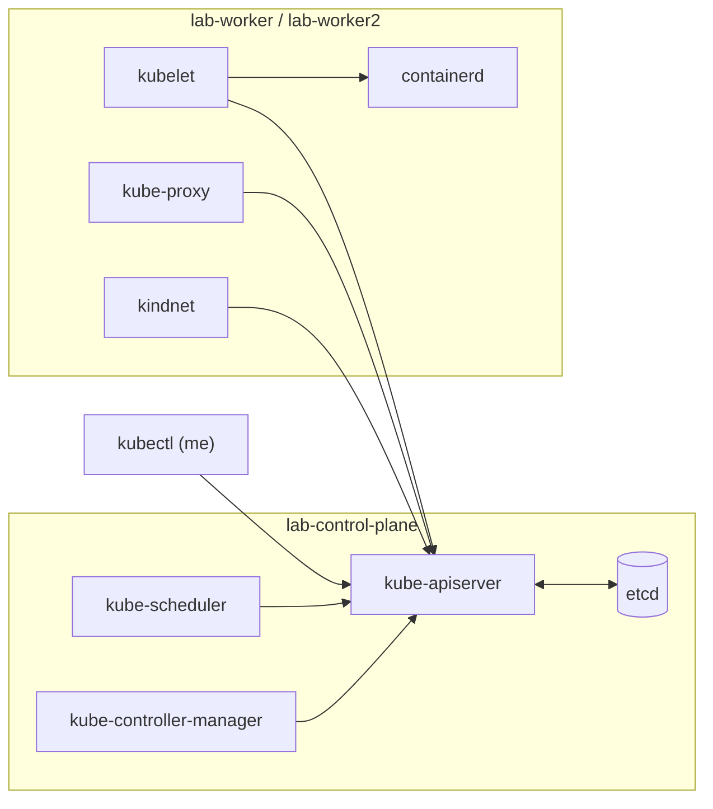

# Anatomy of my kind cluster: what each system pod does

| | |
| --- | --- |
| **Author** | Cody |
| **Created** | 2026-11-22 |
| **Last updated** | _2026-11-24_ |
| **Plan phase** | Phase 0 · Local lab setup |
| **Status** | Draft |

## Purpose

I'm new to Kubernetes, and before building anything on top of it I want to understand what is actually running inside a fresh cluster.
This note documents every system component in my kind lab: what it does, how it gets started, and what breaks without it. By the end I
should be able to sketch the cluster on a whiteboard and explain how a single `kubectl` command turns into running containers.

## Environment

Captured with `kubectl get nodes -o wide` on 2026-11-22.

| Item | Value |
| --- | --- |
| Host | Windows 11 · Ryzen 7 9700X · 32 GB RAM · WSL2 (Ubuntu 24.04) |
| Cluster tool | kind · config in [`clusters/lab.yaml`](../clusters/lab.yaml) |
| Kubernetes version | v1.37.0 |
| Container runtime | containerd 2.3.4 |
| Node OS / kernel | Debian GNU/Linux 13 (trixie) · 6.6.87.1-microsoft-standard-WSL2 |
| Network plugin (CNI) | kindnet |

### Nodes

| Node | Role | Internal IP | Notes |
| --- | --- | --- | --- |
| `lab-control-plane` | control-plane | 172.18.0.4 | _What runs here that doesn't run on the workers?_ |
| `lab-worker` | worker | 172.18.0.2 | |
| `lab-worker2` | worker | 172.18.0.3 | |

## Cluster at a glance



_One sentence describing the picture in your own words, for example who talks to whom and through what._

## Control plane (static pods)

These run only on `lab-control-plane`. The kubelet starts them directly from manifest files in `/etc/kubernetes/manifests`, not through the API server.

| Component | Pod | What it does | What breaks without it | Source |
| --- | --- | --- | --- | --- |
| etcd | `etcd-lab-control-plane` | The cluster's database to store its persistent state. It's used by the API server to store and retrieve information about the cluster. It's a consistent and highly-available key value store (My kind cluster runs a single etcd member, so it is not HA). Every object you create ends up here. | _TODO_ | [K8s components](https://kubernetes.io/docs/concepts/overview/components/) |
| kube-apiserver | `kube-apiserver-lab-control-plane` | The front door. It is the only component that talks to etcd, every other component goes through the apiserver. It checks who you are (authentication), what you may do (authorization) and whether the request is valid (admission), then saves the object to etcd. It exposes a REST API to allow clients to interact with the control plane and submit requests to manage the cluster. | _TODO_ | [K8s components](https://kubernetes.io/docs/concepts/overview/components/) |
| kube-scheduler | `kube-scheduler-lab-control-plane` | Picks a node for each new pod. It filters out nodes that can't take it (not enough unrequested CPU/memory, or a taint the pod doesn't tolerate), scores the rest, and writes the choice on the pod. The kubelet on that node then starts it. | _TODO_ | [K8s components](https://kubernetes.io/docs/concepts/overview/components/) |
| kube-controller-manager | `kube-controller-manager-lab-control-plane` | Runs controllers to manage the state of the cluster. These are the loops that notice when what's running differs from what you asked for and fix it. | _TODO_ | [Cluster architecture](https://kubernetes.io/docs/concepts/architecture/) |

**Key insight:** _What surprised you, or what is the one thing to remember about the control plane?_

## Node components (DaemonSets: one pod per node)

| Component | Pods | What it does | What breaks without it | Source |
| --- | --- | --- | --- | --- |
| kube-proxy | 3 × `kube-proxy-*` | Makes Services work. It turns each Service's virtual IP into kernel rules (iptables/nftables) that forward connections to one of the healthy pods behind it. | _TODO_ | [K8s components](https://kubernetes.io/docs/concepts/overview/components/) |
| kindnet | 3 × `kindnet-*` | This is kind's network plugin. It gives every pod an IP address and sets up routes between nodes so for example a pod on lab-worker can reach a pod on lab-worker2. | _TODO_ | [kindnet design](https://kindnet.sigs.k8s.io/docs/design/kindnet/) |

**Key insight:** _Why is there exactly one of each per node?_

## Add-ons (Deployments)

| Component | Namespace | Replicas | What it does | What breaks without it | Source |
| --- | --- | --- | --- | --- | --- |
| CoreDNS | `kube-system` | 2 | A DNS server inside the cluster so pods can find services by domain name instead of IP address. Pods find it through the kube-dns Service. It also forwards names outside the cluster to an upstream DNS server. | _TODO_ | [DNS for Services and Pods](https://kubernetes.io/docs/concepts/services-networking/dns-pod-service/) |
| local-path-provisioner | `local-path-storage` | 1 | Provides pods with access to local storage on a node. When a PersistentVolumeClaim is created, it creates a PersistentVolume backed by a folder on one node, so a pod using it is tied to the node.  | _TODO_ | [rancher/local-path-provisioner](https://github.com/rancher/local-path-provisioner) |

**Key insight:** _Why does CoreDNS run two replicas instead of one?_

## Not pods: services running on every node

| Component | Runs as | What it does | What breaks without it | How I checked |
| --- | --- | --- | --- | --- |
| kubelet | systemd service on each node | Watches the apiserver for which pods to run on the node and ensures that the desired state of the pods is maintained. It also runs static pods from /etc/kubernetes/manifests, which is how the control plane starts. | _TODO_ | `docker exec lab-worker systemctl status kubelet` |
| containerd | systemd service on each node | Runs the containers on the nodes. Pulls container images, starts/stops containers, and manages their resources. | _TODO_ | `docker exec lab-worker crictl ps` |

## How a request flows

What happens, step by step, after I run `kubectl create deployment web --image=nginx --replicas=3`:

1. `kubectl` → _TODO_
2. kube-apiserver → _TODO_
3. etcd → _TODO_
4. kube-controller-manager → _TODO_
5. kube-scheduler → _TODO_
6. kubelet → _TODO_
7. containerd → _TODO_
8. kindnet / kube-proxy → _TODO_

## Reading pod names

| Pattern | Example from my cluster | Created by | How to confirm |
| --- | --- | --- | --- |
| `<name>-<node-name>` | `etcd-lab-control-plane` | _TODO_ | `docker exec lab-control-plane ls /etc/kubernetes/manifests` |
| `<name>-<replicaset-hash>-<random>` | `coredns-559f6c778d-8hlt7` | _TODO_ | `k -n kube-system get deploy,rs` |
| `<name>-<random>` | `kindnet-kq6z6` | _TODO_ | `k -n kube-system get daemonset` |

## Experiments: what I broke and what happened

Proving behaviour beats repeating documentation. Run each test, record the result, then restore the cluster.

| # | What I did | What I expected | What actually happened | Lesson |
| --- | --- | --- | --- | --- |
| 1 | `k -n kube-system delete pod -l k8s-app=kube-dns` | _TODO_ | _TODO_ | _TODO_ |
| 2 | `k -n kube-system scale deploy coredns --replicas=0`, then resolve a Service name from a test pod | _TODO_ | _TODO_ | _TODO_ |
| 3 | `docker exec lab-worker systemctl stop kubelet`, then `k get nodes -w` | _TODO_ | _TODO_ | _TODO_ |
| 4 | `docker exec lab-control-plane mv /etc/kubernetes/manifests/kube-scheduler.yaml /tmp/`, then create a pod | _TODO_ | _TODO_ | _TODO_ |

> Restore after each test: scale CoreDNS back to 2, `systemctl start kubelet`, and move the scheduler manifest back.

## Commands I used to find this out

```bash
kubectl get nodes -o wide
kubectl get pods -A -o wide
kubectl -n kube-system get deploy,daemonset,rs
kubectl -n kube-system describe pod etcd-lab-control-plane
docker exec lab-control-plane ls /etc/kubernetes/manifests
docker exec lab-worker systemctl status kubelet
kubectl explain pod.spec
```

## How this maps to later phases

| Concept here | Where it shows up again |
| --- | --- |
| Static pods and manifests | _TODO: CKA (Phase 2), Kubernetes the Hard Way_ |
| DaemonSets (one per node) | _TODO: SPIRE agent (Phase 1), Istio ztunnel (Phase 3)_ |
| CNI / pod networking | _TODO: Istio ambient (Phase 3)_ |
| Control plane on a managed service | _TODO: EKS hides the control plane (Phase 2)_ |

## Open questions

- [ ] _TODO_
- [ ] _TODO_

## References

- [Kubernetes Components](https://kubernetes.io/docs/concepts/overview/components/)
- [Cluster Architecture](https://kubernetes.io/docs/concepts/architecture/)
- [DNS for Services and Pods](https://kubernetes.io/docs/concepts/services-networking/dns-pod-service/)
- [kindnet design](https://kindnet.sigs.k8s.io/docs/design/kindnet/)
- [rancher/local-path-provisioner](https://github.com/rancher/local-path-provisioner)

## Changelog

| Date | Change |
| --- | --- |
| 2026-11-22 | Initial draft from fresh kind cluster |
| 2026-11-24 | Completed notes on the cluster architecture and how it works |