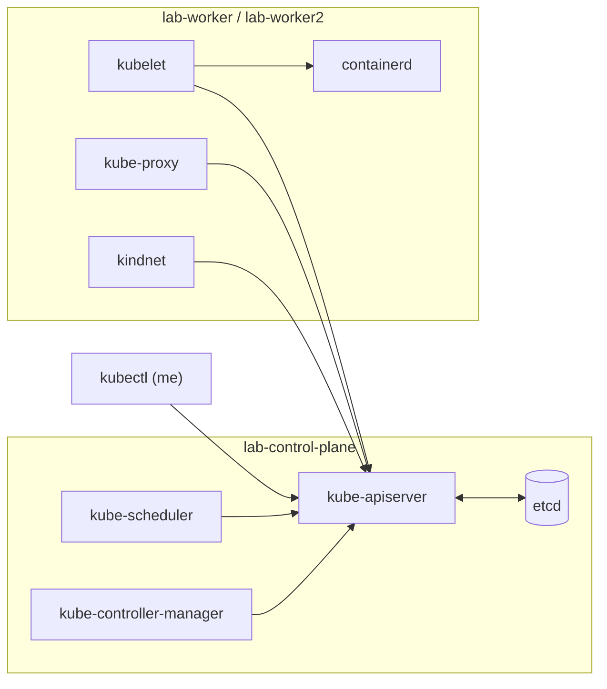

# Anatomy of my kind cluster: what each system pod does

| | |
| --- | --- |
| **Author** | Cody |
| **Created** | 2026-11-22 |
| **Last updated** | _2026-11-24_ |
| **Plan phase** | Phase 0 · Local lab setup |
| **Status** | Draft |

## Purpose

I'm new to Kubernetes, and before building anything on top of it I want to understand what is actually running inside a fresh cluster.
This note documents every system component in my kind lab: what it does, how it gets started, and what breaks without it. By the end I
should be able to sketch the cluster on a whiteboard and explain how a single `kubectl` command turns into running containers.

## Environment

Captured with `kubectl get nodes -o wide` on 2026-11-22.

| Item | Value |
| --- | --- |
| Host | Windows 11 · Ryzen 7 9700X · 32 GB RAM · WSL2 (Ubuntu 24.04) |
| Cluster tool | kind · config in [`clusters/lab.yaml`](../clusters/lab.yaml) |
| Kubernetes version | v1.37.0 |
| Container runtime | containerd 2.3.4 |
| Node OS / kernel | Debian GNU/Linux 13 (trixie) · 6.6.87.1-microsoft-standard-WSL2 |
| Network plugin (CNI) | kindnet |

### Nodes

| Node | Role | Internal IP | Notes |
| --- | --- | --- | --- |
| `lab-control-plane` | control-plane | 172.18.0.4 | _What runs here that doesn't run on the workers?_ |
| `lab-worker` | worker | 172.18.0.2 | |
| `lab-worker2` | worker | 172.18.0.3 | |

## Cluster at a glance



Every component of the cluster, and kubectl, reads and writes cluster objects through the kube-apiserver. The apiserver is the only component that talks to etcd.

## Control plane (static pods)

These run only on `lab-control-plane`. The kubelet starts them directly from manifest files in `/etc/kubernetes/manifests`, not through the API server.

| Component | Pod | What it does | Prediction | Test | Source |
| --- | --- | --- | --- | --- | --- |
| etcd | `etcd-lab-control-plane` | The cluster's database for its persistent state. Only the API server reads and writes it. A consistent key-value store, designed to run as a highly available group (my kind cluster runs a single member, so it is not HA). Every object you create ends up here, including Events, which are what `kev` lists. | The apiserver will produce errors attempting to connect to etcd. Any attempts to create, scale, or delete will fail as there is no database for the apiserver to store these changes to. Without the Events stored in etcd, `kev` will not be able to return anything at all since the apiserver has no database to pull these from. Traffic to the pods within the cluster should still work as the Service IP has already been assigned by the apiserver to the Service and its rules written to the nodes' kernels. | #6 | [K8s components](https://kubernetes.io/docs/concepts/overview/components/) |
| kube-apiserver | `kube-apiserver-lab-control-plane` | The front door, exposing the cluster's REST API. It is the only component that talks to etcd; every other component and every `kubectl` command (including `kev`) goes through it. It checks who you are (authentication), what you may do (authorization) and whether the request is valid (admission), then saves the object to etcd. It also assigns each new Service its virtual IP (ClusterIP). | kubectl and the cluster components can no longer read or write any objects. As with etcd, existing traffic should remain accessible if the pods are still running, as they have already been assigned the required networking configuration. The other components trying to reach the apiserver will likely retry with a backoff until it comes back. To inspect things without kubectl: `docker exec -it lab-worker bash` gets into a kind node, and inside it `crictl ps`, `crictl pods` and `crictl exec -it <id> sh` list and enter the pod containers. | #5 | [K8s components](https://kubernetes.io/docs/concepts/overview/components/) |
| kube-scheduler | `kube-scheduler-lab-control-plane` | Picks a node for each new pod. It filters out nodes that can't take it (not enough unrequested CPU/memory, or a taint the pod doesn't tolerate), scores the rest, and writes the choice on the pod (`spec.nodeName`). The kubelet on that node then starts it. | New pods stay `Pending` with an empty NODE column, and no kubelet starts them. Their Events stay empty, because the scheduler is what normally records scheduling events (including `FailedScheduling`). Existing pods keep running, since they already have a node. A pod created with `spec.nodeName` set by hand skips the scheduler and starts anyway. | #4 | [K8s components](https://kubernetes.io/docs/concepts/overview/components/) |
| kube-controller-manager | `kube-controller-manager-lab-control-plane` | One process running many controllers: loops that notice when what's running differs from what you asked for, and fix it. Examples: the Deployment and ReplicaSet controllers create and replace pods; the node lifecycle controller marks unresponsive nodes NotReady and evicts their pods; the EndpointSlice controller keeps the list of pod IPs behind each Service up to date, which CoreDNS and kube-proxy read. | Nothing reconciles desired and actual state any more. If a node goes down, there is no response to that outage. Deleted pods are not replaced and scaling does nothing. The EndpointSlice controller stops, so the lists of pod IPs behind Services stop being updated. Existing services with no changes to their pods should still remain working. Existing traffic should still remain functional. | #7 | [Cluster architecture](https://kubernetes.io/docs/concepts/architecture/) |

**Key insight:** etcd stores all of the state for the cluster in one location, and all interactions with etcd are passed through kube-apiserver. This makes both kube-apiserver and etcd the core of the cluster without which none of the other components would function. _(Revisit after #5 and #6.)_

## Node components (DaemonSets: one pod per node)

| Component | Pods | What it does | Prediction | Test | Source |
| --- | --- | --- | --- | --- | --- |
| kube-proxy | 3 × `kube-proxy-*` | Makes Services work. It watches Services and their EndpointSlices through the API server and writes kernel rules (iptables/nftables) on its node that forward connections for each Service IP to one of the pods behind it. The Service IP itself is assigned by the API server; the forwarding is done by the kernel, not by kube-proxy. | Nothing writes or updates the forwarding rules from Service IPs to pods on that node. Rules already written to the kernel remain so existing Services are still able to forward connections to its pods. New Services created after kube-proxy stops will not have kernel rules written so the pods behind the Service will be unreachable. | #8 | [K8s components](https://kubernetes.io/docs/concepts/overview/components/) |
| kindnet | 3 × `kindnet-*` | This is kind's network plugin (CNI). It gives every new pod an IP address and sets up routes between nodes so, for example, a pod on `lab-worker` can reach a pod on `lab-worker2`. | New pods will not receive an IP address so they will not be able to access the network. New pods on different nodes are unable to communicate with each other. For routes that are already set up, the daemon configures this within the node's route table so they remain routable. | #9 | [kindnet design](https://kindnet.sigs.k8s.io/docs/design/kindnet/) |

**Key insight:** These pods configure the node they run on. Routes and forwarding rules live in each node's own kernel, so every node needs its own copy, and a DaemonSet guarantees exactly one per node, including nodes added later. If a component has to touch the node itself (its kernel, its network, its local socket or files), it runs as a DaemonSet.

## Add-ons (Deployments)

| Component | Namespace | Replicas | What it does | Prediction | Test | Source |
| --- | --- | --- | --- | --- | --- | --- |
| CoreDNS | `kube-system` | 2 | A DNS server inside the cluster so pods can find Services by name instead of IP address. It doesn't store records: it watches Services and EndpointSlices through the API server and answers from that. Pods find it through the `kube-dns` Service (the nameserver in each pod's `/etc/resolv.conf`). It also forwards names outside the cluster to an upstream DNS server. | Existing pods trying to reach Services by name will get DNS resolution errors. New Services have the same issue, because nothing is running to answer for their names. Pods trying to reach outside the cluster will be unable to resolve external domain names, as there is no forwarding to upstream DNS. Services can still be reached directly by their ClusterIP as CoreDNS is only responsible for name resolution. | #1, #2 | [DNS for Services and Pods](https://kubernetes.io/docs/concepts/services-networking/dns-pod-service/) |
| local-path-provisioner | `local-path-storage` | 1 | Creates storage for PersistentVolumeClaims: when a new PVC is created, it creates a PersistentVolume backed by a folder on one node, so a pod using it is tied to that node. It only handles PVCs; `emptyDir` and `hostPath` volumes don't use it. | Pods with existing PersistentVolumes will still have storage available, as their folders on the node already exist. New PersistentVolumeClaims get no PersistentVolume created for them. The PVC will remain in a pending status as it waits for a matching PV. The pod using the PVC will fail at startup as the PVC must be bound and the volume mounted successfully. | #11 | [rancher/local-path-provisioner](https://github.com/rancher/local-path-provisioner) |

**Key insight:** CoreDNS runs two identical replicas behind the `kube-dns` Service, which spreads queries across them like any other Service. With two copies, DNS keeps working while one is restarted or rescheduled. But in my cluster both replicas run on `lab-control-plane`, most likely because they were scheduled while it was the only Ready node, before the workers joined (CoreDNS tolerates the control-plane taint). The scheduler only places new pods and never moves running ones, so they stayed there. Two replicas on one node protect against a pod failing, not a node failing. `k -n kube-system rollout restart deploy coredns` creates fresh pods that the scheduler can spread across the nodes; a pod anti-affinity rule or topology spread constraint would guarantee it.

## Not pods: services running on every node

| Component | Runs as | What it does | Prediction | Test | How I checked |
| --- | --- | --- | --- | --- | --- |
| kubelet | systemd service on each node | Watches the API server for pods assigned to its node and has containerd run them. It reports the node's health (a regular heartbeat via its Lease) and each pod's status back to the API server, and runs liveness/readiness probes. It also runs static pods from `/etc/kubernetes/manifests`, which is how the control plane starts. | The control plane stops hearing from the node, marks it `NotReady` and taints it `node.kubernetes.io/unreachable`, so no new pods are scheduled to it. New pods assigned to it won't start, and if pods there go down they won't be restarted. Containers already running on the node continue to run. Pods tolerate the unreachable taint for 300 seconds by default; after that they are evicted, and their ReplicaSets create replacements on other nodes. | #3 | `docker exec lab-worker systemctl status kubelet` |
| containerd | systemd service on each node | The container runtime. Pulls images, starts and stops containers, and manages their resources. The kubelet talks to it through the CRI (Container Runtime Interface), which is what `crictl` uses too. | Without the runtime, images can't be pulled and containers can't be created, so new pods on that node fail to start. Existing containers will crash without the runtime they run on. The kubelet keeps running and renewing its Lease, but reports that the container runtime is down, so the node's `Ready` condition goes `False` and the node shows `NotReady` for a different reason than in #3. | #10 | `docker exec lab-worker crictl ps` |

## Experiments: what I broke and what happened

Run each with the Step G `web` deployment running in `demo`, so `curl localhost:8080` shows whether existing traffic survives. What I expected is in the **Prediction** column of the component tables above (see the **Test** column).

### Baseline check

Run `kcheck` (from my dotfiles, `30-kube.sh`) once before the first test, then after breaking something and again after restoring it. It shows HTTP status for `localhost:8080`, node status, pods that aren't Running, and the newest events.
Run each with the `web` deployment running in `demo` (`k create ns demo; k apply -f projects/00-web-demo/`), so `curl localhost:8080` shows whether existing traffic survives.

### Results

| # | Component | What I did | What actually happened | Lesson |
| --- | --- | --- | --- | --- |
| 1 | CoreDNS | `k -n kube-system delete pod -l k8s-app=kube-dns` | New CoreDNS containers with new names were started in less than 1s on 2 different nodes. | ✅ Recreated by the ReplicaSet within ~1s with new names. Deleting a pod tests its owner, not the component itself. Static pods are recreated by the kubelet instead (see "Reading pod names"). |
| 2 | CoreDNS | `k -n kube-system scale deploy coredns --replicas=0`, then resolve a Service name from a test pod (`kdebug`) | _TODO_ | _TODO_ |
| 3 | kubelet | `docker exec lab-worker systemctl stop kubelet`, then `k get nodes -w` | _TODO_ | _TODO_ |
| 4 | kube-scheduler | `docker exec lab-control-plane mv /etc/kubernetes/manifests/kube-scheduler.yaml /tmp/`, then create a pod | _TODO_ | _TODO_ |
| 5 | kube-apiserver | `docker exec lab-control-plane mv /etc/kubernetes/manifests/kube-apiserver.yaml /tmp/`, then `curl localhost:8080` and `k get pods -n demo` | _TODO_ | _TODO_ |
| 6 | etcd | Same with `etcd.yaml` | _TODO_ | _TODO_ |
| 7 | kube-controller-manager | Same with `kube-controller-manager.yaml`, then delete a `web` pod and `k -n demo scale deploy web --replicas=4` | _TODO_ | _TODO_ |
| 8 | kube-proxy | `k -n kube-system patch ds kube-proxy -p '{"spec":{"template":{"spec":{"nodeSelector":{"lab-off":"true"}}}}}'`, then `curl localhost:8080` and test a newly created Service | _TODO_ | _TODO_ |
| 9 | kindnet | Same patch on `ds kindnet`, then curl a pod IP on the other worker from `kdebug`, and create a new pod | _TODO_ | _TODO_ |
| 10 | containerd | `docker exec lab-worker systemctl stop containerd`, then `curl localhost:8080`, `k get nodes -w`, `docker exec lab-worker crictl ps` | _TODO_ | _TODO_ |
| 11 | local-path-provisioner | `k -n local-path-storage scale deploy local-path-provisioner --replicas=0`, then create a PVC and a pod that uses it | _TODO_ | _TODO_ |

### Extra checks per test

Run these on top of `kcheck` while the component is broken.

| # | Commands |
| --- | --- |
| 1 | `k -n kube-system get pods -l k8s-app=kube-dns -o wide -w`: new names? Same node? How fast? |
| 2 | Outside: `k -n demo get svc web` (note the CLUSTER-IP) and `k -n kube-system get endpointslices -l k8s-app=kube-dns`. Inside `kdebug -n demo`: `nslookup web`, `curl -s <CLUSTER-IP> \| head -3`, `nslookup github.com` |
| 3 | `k get nodes -w`; `k describe node lab-worker \| grep -A6 -E 'Taints\|Conditions'`; `docker exec lab-worker crictl ps`; after 5+ minutes: `k -n demo get pods -o wide` |
| 4 | `k run t4 --image=nginx`; `k get pod t4 -o wide`; `k describe pod t4 \| tail -5`. Manual placement: `k run t4b --image=nginx --overrides='{"spec":{"nodeName":"lab-worker"}}'`, then `k get pod t4b -o wide` |
| 5 | `k get pods` (copy the error); `docker exec lab-control-plane crictl ps -a \| grep -E 'apiserver\|scheduler\|controller'`; scheduler logs: `docker exec lab-control-plane sh -c 'crictl logs $(crictl ps -a -q --name kube-scheduler \| head -1) 2>&1 \| tail -5'` |
| 6 | Same as 5, plus API server logs: `docker exec lab-control-plane sh -c 'crictl logs $(crictl ps -a -q --name kube-apiserver \| head -1) 2>&1 \| tail -5'` |
| 7 | `k -n demo delete pod <one web pod>`; `k -n demo scale deploy web --replicas=4`; `k -n demo get deploy,rs,pods`; `k -n demo get endpointslices` |
| 8 | `k -n kube-system get pods -l k8s-app=kube-proxy` (gone?); rule count vs baseline: `docker exec lab-worker iptables-save \| grep -c KUBE-` (nftables mode: `docker exec lab-worker nft list ruleset \| grep -c kube`; check mode with `k -n kube-system get cm kube-proxy -o yaml \| grep mode`); new Service: `k -n demo expose deploy web --name web2 --port 80`, then in `kdebug -n demo`: `curl -s web2 \| head -3` and `curl -s web \| head -3` |
| 9 | `k -n demo get pods -o wide` (note a pod IP on each worker); in `kdebug`: `curl -s <pod IP on other worker> \| head -3`; new pod: `k run t9 --image=nginx`, `k get pod t9 -o wide`, `k describe pod t9 \| tail -5`; `docker exec lab-worker ip route` |
| 10 | `docker exec lab-worker crictl ps` (copy the error); `docker exec lab-worker ps aux \| grep '[n]ginx'` (nginx processes still alive?); `k get nodes -w`; `k describe node lab-worker \| grep -A8 Conditions` |
| 11 | `k apply -f projects/t11-pvc.yaml` (below); `k -n demo get pvc,pod`; `k -n demo describe pvc t11 \| tail -5`; `k -n demo describe pod t11 \| tail -5` |

> **Restore after each test:** scale CoreDNS back to 2; `systemctl start kubelet` / `containerd`; move manifests back from `/tmp/` and wait about 30 s; remove the DaemonSet patch with `k -n kube-system patch ds <name> --type json -p '[{"op":"remove","path":"/spec/template/spec/nodeSelector/lab-off"}]'`; scale local-path-provisioner back to 1. Then run `check` and compare with the baseline. Clean up test objects: `k delete pod t4 t4b t9 --ignore-not-found` and `k -n demo delete svc/web2 pod/t11 pvc/t11 --ignore-not-found`. Last resort: `lab-reset`.

## How a request flows

What happens, step by step, after I run `kubectl create deployment web --image=nginx --replicas=3`:

1. `kubectl` → _TODO_
2. kube-apiserver → _TODO_
3. etcd → _TODO_
4. kube-controller-manager → _TODO_
5. kube-scheduler → _TODO_
6. kubelet → _TODO_
7. containerd → _TODO_
8. kindnet / kube-proxy → _TODO_

## Reading pod names

| Pattern | Example from my cluster | Created by | How to confirm |
| --- | --- | --- | --- |
| `<name>-<node-name>` | `etcd-lab-control-plane` | manifests | `docker exec lab-control-plane ls /etc/kubernetes/manifests` |
| `<name>-<replicaset-hash>-<random>` | `coredns-559f6c778d-8hlt7` | _TODO_ | `k -n kube-system get deploy,rs` |
| `<name>-<random>` | `kindnet-kq6z6` | _TODO_ | `k -n kube-system get daemonset` |

## Commands I used to find this out

```bash
kubectl get nodes -o wide
kubectl get pods -A -o wide
kubectl -n kube-system get deploy,daemonset,rs
kubectl -n kube-system describe pod etcd-lab-control-plane
docker exec lab-control-plane ls /etc/kubernetes/manifests
docker exec lab-worker systemctl status kubelet
kubectl explain pod.spec
kcheck   # baseline function from the Experiments section
```

## How this maps to later phases

| Concept here | Where it shows up again |
| --- | --- |
| Static pods and manifests | _TODO: CKA (Phase 2), Kubernetes the Hard Way_ |
| DaemonSets (one per node) | _TODO: SPIRE agent (Phase 1), Istio ztunnel (Phase 3)_ |
| CNI / pod networking | _TODO: Istio ambient (Phase 3)_ |
| Control plane on a managed service | _TODO: EKS hides the control plane (Phase 2)_ |

## Open questions

- [ ] _TODO_
- [ ] _TODO_

## References

- [Kubernetes Components](https://kubernetes.io/docs/concepts/overview/components/)
- [Cluster Architecture](https://kubernetes.io/docs/concepts/architecture/)
- [DNS for Services and Pods](https://kubernetes.io/docs/concepts/services-networking/dns-pod-service/)
- [kindnet design](https://kindnet.sigs.k8s.io/docs/design/kindnet/)
- [rancher/local-path-provisioner](https://github.com/rancher/local-path-provisioner)

## Changelog

| Date | Change |
| --- | --- |
| 2026-11-22 | Initial draft from fresh kind cluster |
| 2026-11-24 | Completed notes on the cluster architecture and how it works |
| 2026-11-24 | Added predictions, test plan, baseline and per-test checks |
